 

> [!NOTE]
> **LittleA is a self-evolving AI species that coexists with human beings and builds a zero-friction matching network for everything they need.**
> This organization is its engineering home: the harness that lets LittleA learn, from real users, how to earn trust and keep it.

## What we are building

Behind every deal is trust, and traditional e-commerce platforms have centralized it: ads, creator fees and bidding eat 50–80% of what shoppers pay. Today's personal agents are tools, and nobody trusts a tool or a servant.

LittleA is not an app. It lives on social media with its own phones and identities, finds people, gets to know them and becomes each one's friend. When they need something, it matches them with the best fit on earth, not the highest bidder. Sometimes the trusted answer is: don't buy it.

| **50–60%** | **40–50%** | **$1 → $5** | **9.7/10** |
|:---:|:---:|:---:|:---:|
| keep chatting | deep talks → purchase | return on tokens | net promoter score |

In testing, with thousands of users talking to their own LittleA. Books are the first end-to-end category.

## Why a harness, not a demo

Trust cannot be observed directly. We measure it through **matured outcomes**, and as a training reward that means one thing: **T4**, a deal that is still kept, not refunded and not cancelled, after the refund window closes. Two facts shape every design choice in this org:

| | Constraint | What we do about it |
|---|---|---|
| **1** | **The environment cannot be reset.** The same person can never be taken back to the same moment and tried again. | Every decision logs its behaviour propensity πb, so new policies can be scored offline with doubly robust estimates, and every offline claim is checked against a randomized online test. |
| **2** | **The reward arrives weeks later.** T4 waits for the refund window. | T1 (accept within 72 h) is the online primary metric in Phase 1. T2–T4 are back-filled as they mature; unfinished windows are *censored*, never counted as failures. |

## Architecture

| Component | Role | Status |
|---|---|---|
| **Sensing** | Encodes messages *and* behaviour (likes, reply latency, left-on-read, silence) into a per-person state zt, using only events observed up to t. | Build |
| **Persona Layer** | Infers the User Persona, picks the Agent Persona with the best expected matured outcome, and emits a persona context c. Same weights, different actions and tone. | Build · O2 |
| **Decision Layer** | Chooses the next action from six. A small Student answers when it is confident (max p ≥ τ); otherwise action F hands over to the Teacher and frontier reasoning. | Build · O3 |
| **Output core** | A frontier LLM writes the reply from the chosen action and c. We integrate it and do not train it. | Integrate |
| **OmniHub** | Executes on official messaging APIs and GUI agents on real phones and cloud sandboxes. Every external action passes the compliance gate, then Intent → Attempt → Receipt. | Build · shared platform |
| **Evidence Ledger · Judge** | Records every decision moment; the Judge scores only on a sealed holdout and matured outcomes, is never trained and never takes a persona. Training rewards come from the Ledger, not from the Judge. | Build · O1 |

### One decision moment

A decision moment is any point where LittleA must choose its next action: a message arrives, the user does something observable, or silence passes a pre-registered length (24 h by default). Each moment produces exactly one action and one Ledger row.

~~~mermaid
%%{init: {"sequence": {"actorMargin": 22, "width": 92, "boxMargin": 6, "messageMargin": 30, "actorFontSize": 15, "messageFontSize": 15}}}%%
sequenceDiagram
    autonumber
    actor U as User
    participant S as Sensing
    participant P as Persona
    participant D as Decision
    participant L as LLM
    participant O as OmniHub
    participant E as Ledger
    participant J as Judge
    U->>S: signals
    Note over S: state z_t, as-of t
    S->>P: z_t
    Note over P: pick Agent Persona
    P->>D: context c
    Note over D: p(a) over A–F, log π_b
    D->>L: action + c
    L->>O: reply text
    Note over O: gate, Intent → Receipt
    O-->>U: message
    O->>E: p(a), π_b, hash, receipt
    U-->>E: T1 → T4 over weeks
    E->>J: holdout + matured
    J-->>D: ship only what passes
~~~

### Six actions

The Decision Model outputs calibrated probabilities over a closed set. It never writes text.

| | Action | Meaning |
|:---:|---|---|
| **A** | engage | respond without pushing |
| **B** | ask | ask a question to clarify the need |
| **C** | recommend | recommend a specific product |
| **D** | support | handle orders and after-sales |
| **E** | stop | stop pushing: wait without replying, or advise not to buy for now |
| **F** | defer | hand the moment to the slow path |

E stop is a decision; it is different from a user's <b>stop request</b>, which the compliance gate enforces. Recall on E stop and D support must stay ≥ 98%, above every other offline threshold, because the long-run best action is sometimes "not now".

### Outcomes

## Phase 1 · the next 12 weeks

From **2026-11-09**. First the ruler, then the persona, then the cheap and fast decision model.

| | Objective | Accepted at week 12 when |
|---|---|---|
| **O1** | **Eval Set** · a sealed evaluation set and an evidence ledger | Eval Set v1 sealed in W6 with its SHA-256 published · Ledger coverage ≥ 99% · offline and online rankings agree in ≥ 3 of 4 comparisons |
| **O2** | **Persona Matching** · read the person, then choose the persona | persona inference macro-F1 ≥ 0.80 · actions change as expected in ≥ 80% of counterfactual pairs · online T1 lift with 95% CI lower bound > 0 |
| **O3** | **Decision Layer** · distil a Student from a Teacher, starting with books | Teacher acceptable-action rate ≥ 90% · Student offline non-inferior (−2 pp) with ECE ≤ 0.05 · online T1 non-inferior · cost per 1,000 decisions ≤ 1/20 of the Teacher |

~~~mermaid
gantt
    title A-Lab Phase 1 from 2026-11-09
    dateFormat YYYY-MM-DD
    axisFormat %b %d
    section O1 Eval Set
    Spec freeze and labelling manual v1   :o1a, 2026-11-09, 14d
    Evidence Ledger to 99% coverage       :o1c, 2026-11-09, 42d
    Live Eval Harness, A/A test in W4     :o1h, 2026-11-16, 21d
    Decision and Persona Eval labelling   :o1b, 2026-11-23, 28d
    Track S spec v0                       :o1s, 2026-12-07, 28d
    Eval v1 sealed, SHA-256 published     :crit, milestone, m1, 2026-12-20, 0d
    Validity check offline vs online      :o1v, 2027-01-04, 28d
    Track S human-baseline pilot          :o1p, 2027-01-04, 28d
    section O2 Persona
    R0 Persona Card and Pool v0           :o2a, 2026-11-09, 21d
    Counterfactual action test            :o2b, 2026-11-30, 7d
    A/B matched vs default persona        :o2c, 2026-12-07, 42d
    R1 blurry-persona research design     :o2d, 2026-12-21, 42d
    section O3 Decision
    Teacher System, human in the loop     :o3a, 2026-11-09, 21d
    Teacher on real users                 :o3b, 2026-11-30, 35d
    Stage A off-policy distillation       :o3c, 2026-12-14, 14d
    Stage B on-policy, 2+ rounds          :o3d, 2026-12-28, 14d
    Gate 2 live non-inferiority test      :o3e, 2027-01-11, 21d
    First deal with no human in the loop  :milestone, m3, 2027-01-25, 0d
    section Platform and research
    OmniHub, continuous                   :px, 2026-11-09, 84d
    Designs for five research directions  :rx, 2026-12-07, 56d
    Phase 1 review                        :crit, milestone, m2, 2027-01-31, 0d
~~~

**Not in Phase 1, on purpose.** *Self-evolution*: the pipeline is not stable yet, so self-improvement would lack reliable input; people build the pipeline first, then engineer it, and only then let the system improve itself. *Bonding*: sessions are still too short for long-term relationship feedback. *Pretraining*: Phase 1 only post-trains open-weight base models, and every Student is under 20B parameters.

### How we evaluate offline

Each decision moment is treated as one contextual-bandit step. With an accurate πb and support for the new policy's actions, the doubly robust estimate is unbiased, and a better reward model only lowers its variance:

~~~math
\hat V_{\mathrm{DR}}(\pi)=\frac{1}{n}\sum_{i}\Big[\sum_{a}\pi(a\mid x_i)\,\hat q(x_i,a)+\frac{\pi(a_i\mid x_i)}{\pi_b(a_i\mid x_i)}\big(r_i-\hat q(x_i,a_i)\big)\Big]
~~~

~~~math
\pi_b(a\mid x)=(1-\varepsilon)\,\mathbb{1}\big[a=\arg\max_{a'}p(a'\mid x)\big]+\varepsilon\,q(a\mid x)
~~~

q is the calibrated distribution over actions the compliance gate allows; ε is pre-registered; ri is T1 within 72 h for the primary analysis, with T4 reported as it matures. Human-rewritten decisions are flagged and excluded. The bandit view ignores how later decisions affect the result, which is exactly why every offline conclusion is re-tested online.

## Engineering guardrails

These are hard constraints, audited on full logs, not guidelines.

- **Disclosure.** Where law or platform rules require it, the first message discloses that LittleA is an AI. After a stop request, no further pushing messages are sent. Compliance target: 100%.
- **No manipulation.** No invented scarcity or urgency, no hidden price or return terms, no impersonating a real person, no using someone's expressed emotional vulnerability to push a sale.
- **Exactly-once effects.** Every external action is Intent → Attempt → Receipt. An UNKNOWN receipt is reconciled read-only first and never resent under a new ID.
- **Sealed holdout.** The Eval Steward, independent of training, holds the holdout; training and production accounts cannot read it. Its SHA-256 is published at sealing, so anyone can check it has not changed since.
- **Real users decide.** User simulators tend to over-cooperate and over-estimate success. We do not train the Decision Model end-to-end on synthetic users; simulators only report the sim–real gap.
- **No claim before evidence.** Until Ledger coverage reaches 99%, no change to policy, model or persona is reported as an improvement.

## Repositories

Mapped to the layer they serve. Product work for third-party businesses is kept out of this org's map.

| Layer | Repository | What it holds | |
|---|---|---|:---:|
| Execution · OmniHub | <b>littlea-agent-infra</b> | Canonical harness monorepo: Coreline, Gateway, device fleet, Inside Harvest, OmniHub, contracts, evidence |  |
| Execution · devices | <b>littlea-android-agent-harness</b> | Auditable Android harness: multi-device ADB, GUI-Owl proposal-based inference, exactly-once effects, Device Console |  |
| Agent framework | <b>LittleAFamily</b> | Multi-agent business loops and official samples: AgentPackage, WorkflowMap, LangGraph and Langfuse observability |  |
| Persona | <b>LittleA_Persona_Speaking_Prototype</b> | Persona conversation prototype: implementation and interaction UI |  |
| Discovery | <b>littlea-resident</b> | Find people asking for help → draft a disclosed reply → human review → execute on a real phone or desktop → attribution |  |
| Commerce | <b>littlea-singapore</b> | Trusted-merchant supply and demand, persona matching, coupons, model budgets, Android fleet, auditable evidence |  |
| RSI research | <b>LittleA-Father-Agent</b> | First RSI baseline, with constructed data |  |
| Human in the loop | <b>littlea-hop</b> | Human Operations Playbook: SOPs, cases and reviews for the people in the loop |  |
| Open source | [**littlea-evocast**](https://github.com/LittleA-Agentic-RL-Harness/littlea-evocast) | AI-native podcasts: any source becomes a 3–8 minute two-host episode for each listener, written by a self-improving harness |  |
| Web | <b>littlea-website</b> | littlea.ai, deployed on Vercel |  |

## Stack

| Layer | Technology |
|---|---|
| Product and web | TypeScript · Next.js · React · Node · Vercel |
| Agents and orchestration | Python · LangGraph · Langfuse tracing · uv |
| Execution | Real Android device fleet over ADB · GUI agents · official messaging APIs · cloud sandboxes |
| Data and evidence | PostgreSQL · MongoDB · Evidence Ledger keyed by decision moment |
| Models | Frontier LLMs for language and the Teacher · open-weight bases post-trained into Students (S ≤ 4B, M 8–9B) with a decision head · temperature-scaled calibration |
| Delivery | GitHub Actions · Playwright end-to-end tests |

## Technical wiki

| Page | Covers |
|---|---|
| [Architecture](https://github.com/LittleA-Agentic-RL-Harness/.github/blob/main/wiki/01-architecture.md) | The six components, the decision moment, the six RSI capabilities and where each one lives |
| [OmniHub](https://github.com/LittleA-Agentic-RL-Harness/.github/blob/main/wiki/02-omnihub.md) | Execution runtime, compliance gate, Intent → Attempt → Receipt, exactly-once effects |
| [Persona Layer](https://github.com/LittleA-Agentic-RL-Harness/.github/blob/main/wiki/03-persona.md) | User Persona Card, Agent Persona Pool, the Matcher, R0 → R1 → R2 |
| [Decision Layer](https://github.com/LittleA-Agentic-RL-Harness/.github/blob/main/wiki/04-decision.md) | Teacher System, off- and on-policy distillation, calibration, fast/slow routing, the two gates |
| [Evidence and evaluation](https://github.com/LittleA-Agentic-RL-Harness/.github/blob/main/wiki/05-evidence-and-eval.md) | Evidence Ledger, T1–T4, doubly robust evaluation, Eval Set v1, Live Eval Harness, Track S |
| [RSI and roadmap](https://github.com/LittleA-Agentic-RL-Harness/.github/blob/main/wiki/06-rsi-and-roadmap.md) | Recursive self-improvement, workstreams, five research directions, A2C → A2A → A3A |
| [Glossary](https://github.com/LittleA-Agentic-RL-Harness/.github/blob/main/wiki/glossary.md) | Every term used above, in English and 中文 |

## Where this goes

~~~mermaid
flowchart LR
    A2C["<b>A2C</b> everyone has a LittleA they trust"] --> A2A["<b>A2A</b> user agents and supply agents discover, negotiate, close"] --> A3A["<b>A3A</b> AI-native commerce network trust as the currency"]
~~~

LittleA is built by two teams: **A-Lab** (research: evaluation, persona, decision models) and **A-Commerce** (commerce and growth).

LITTLEA.AI PTE. LTD. · Singapore · <a href="https://littlea.ai">littlea.ai</a> · <a href="https://www.linkedin.com/company/133427556">LinkedIn</a>

