 

> [!NOTE]
> **LittleA 是一个与人类共生的自进化 AI 物种，为人类构建零摩擦的匹配网络。**
> 这个组织是它的工程大本营：一套让 LittleA 在真实用户中学会赢得信任、并保持信任的 harness。

## 我们在做什么

所有交易背后都是信任，而传统电商平台把信任垄断了：广告、达人佣金和竞价吃掉消费者所付价格的 50%–80%。今天的个人 agent 只是工具和仆人，没人信任工具和仆人。

LittleA 不是 App。它活在社交网络里，有自己的手机和身份，主动找到人、读懂人，成为每个人的朋友；对方一有需求，就从全世界为他匹配最合适的东西，而不是谁出价高推谁。有时最值得信任的回答是：别买。

| **50–60%** | **40–50%** | **$1 → $5** | **9.7/10** |
|:---:|:---:|:---:|:---:|
| 持续聊天 | 深度对话成交 | token 回报（ROT） | 净推荐值 NPS |

测试中，数千名用户已与自己的 LittleA 对话；书籍是第一个端到端跑通的品类。

## 为什么是 harness，而不是 demo

信任无法直接观测，我们用 **matured outcome** 间接衡量；作为训练奖励时只指一件事：**T4**，退款期满后仍未退款、未取消的成交。这个组织里的每个设计都受两个事实约束：

| | 约束 | 我们的做法 |
|---|---|---|
| **1** | **环境不可重置。** 同一个人无法回到同一时刻重来。 | 每个决策都记录行为策略的实际执行概率 πb，新策略可以用双重稳健（DR）估计离线打分；每一个离线结论都要用线上随机对照复核。 |
| **2** | **奖励要等数周。** T4 必须等退款期结束。 | Phase 1 的线上主指标是 T1（72 小时内接受），T2–T4 随成熟补报；窗口未满的样本记为 censored，绝不当作失败。 |

## 架构

| 组件 | 作用 | 状态 |
|---|---|---|
| **Sensing** | 把消息与行为（点赞、回复延迟、已读未回、沉默）编码为每个人的状态 zt，只使用观测时间不晚于 t 的事件。 | 自建 |
| **Persona Layer** | 推断 User Persona，选出预期 matured outcome 最高的 Agent Persona，输出 persona context c。模型参数不变，动作分布与语气随之改变。 | 自建 · O2 |
| **Decision Layer** | 从六个动作中选下一个。Student 有把握时（max p ≥ τ）直接给出，否则以 F defer 交给 Teacher 与 frontier reasoning。 | 自建 · O3 |
| **Output core** | frontier LLM 根据所选动作与 c 生成回复文本。我们集成它，不训练它。 | 集成 |
| **OmniHub** | 通过官方消息 API，以及真机与云沙盒上的 GUI agents 执行；每个外部动作先过合规门禁，再走 Intent → Attempt → Receipt。 | 自建 · 共用平台 |
| **Evidence Ledger · Judge** | 按决策时刻记账；Judge 只依据 sealed holdout 与 matured outcome 评估，本身不被训练，也不带 persona。训练奖励取自 Ledger，而不是 Judge 的打分。 | 自建 · O1 |

### 一个决策时刻

决策时刻指 LittleA 需要决定下一个动作的时点：收到消息、用户出现可观测行为，或沉默超过预登记时长（默认 24 小时）。每个决策时刻只产生一个动作、一行账本记录。

~~~mermaid
%%{init: {"sequence": {"actorMargin": 22, "width": 92, "boxMargin": 6, "messageMargin": 30, "actorFontSize": 15, "messageFontSize": 15}}}%%
sequenceDiagram
    autonumber
    actor U as 用户
    participant S as Sensing
    participant P as Persona
    participant D as Decision
    participant L as LLM
    participant O as OmniHub
    participant E as Ledger
    participant J as Judge
    U->>S: 行为与消息信号
    Note over S: 重建状态 z_t（as-of t）
    S->>P: z_t
    Note over P: 选择 Agent Persona
    P->>D: context c
    Note over D: A–F 的 p(a)，记录 π_b
    D->>L: 动作 + c
    L->>O: 回复文本
    Note over O: 合规门禁，Intent → Receipt
    O-->>U: 消息
    O->>E: p(a)、π_b、哈希、receipt
    U-->>E: T1 → T4 数周内成熟
    E->>J: holdout + matured outcome
    J-->>D: 只上线通过评估的版本
~~~

### 六个动作

Decision Model 在闭集上输出校准概率，从不生成文本。

| | 动作 | 含义 |
|:---:|---|---|
| **A** | engage | 回应，不推进 |
| **B** | ask | 提问以澄清需求 |
| **C** | recommend | 推荐具体商品 |
| **D** | support | 处理订单与售后 |
| **E** | stop | 停止推进：不回复等待，或建议暂不购买 |
| **F** | defer | 交给慢路径 |

E stop 是 agent 的决策，不同于用户的<b>停止请求</b>（后者由合规门禁强制执行）。E stop 与 D support 的召回率门槛为 98%，高于其他所有离线指标，因为长期最优的动作有时就是"现在不"。

### 结果怎样才算数

## Phase 1：未来 12 周

自 **2026-11-09** 起。先造尺子，再选人设，最后蒸馏又快又便宜的决策模型。

| | 目标 | 第 12 周验收 |
|---|---|---|
| **O1** | **Eval Set** · 封存的评测集与证据账本 | W6 封存 Eval Set v1 并公布 SHA-256 · Ledger 覆盖率 ≥ 99% · 离线与线上方向一致 ≥ 3/4 |
| **O2** | **Persona Matching** · 先看人，再选人设 | persona 推断 macro-F1 ≥ 0.80 · ≥ 80% 的 counterfactual pairs 动作按预期改变 · 线上 T1 提升，95% CI 下界 > 0 |
| **O3** | **Decision Layer** · 从 Teacher 蒸馏 Student（书籍场景） | Teacher acceptable-action rate ≥ 90% · Student 离线非劣（−2pp）且 ECE ≤ 0.05 · 线上 T1 非劣 · 每千次决策成本 ≤ Teacher 的 1/20 |

~~~mermaid
gantt
    title A-Lab Phase 1（自 2026-11-09）
    dateFormat YYYY-MM-DD
    axisFormat %m-%d
    section O1 Eval Set
    Spec 冻结与标注手册 v1          :o1a, 2026-11-09, 14d
    Evidence Ledger 覆盖率到 99%    :o1c, 2026-11-09, 42d
    Live Eval Harness，W4 做 A/A    :o1h, 2026-11-16, 21d
    Decision 与 Persona Eval 标注   :o1b, 2026-11-23, 28d
    Track S spec v0                 :o1s, 2026-12-07, 28d
    Eval v1 封存，公布 SHA-256      :crit, milestone, m1, 2026-12-20, 0d
    Validity check 离线对线上       :o1v, 2027-01-04, 28d
    Track S 人类基线试点            :o1p, 2027-01-04, 28d
    section O2 Persona
    R0 Persona Card 与 Pool v0      :o2a, 2026-11-09, 21d
    counterfactual 动作测试         :o2b, 2026-11-30, 7d
    A/B matched 对 default persona  :o2c, 2026-12-07, 42d
    R1 blurry persona 研究设计      :o2d, 2026-12-21, 42d
    section O3 Decision
    Teacher System，人工在环        :o3a, 2026-11-09, 21d
    Teacher 面向真实用户            :o3b, 2026-11-30, 35d
    Stage A off-policy 蒸馏         :o3c, 2026-12-14, 14d
    Stage B on-policy，至少 2 轮    :o3d, 2026-12-28, 14d
    Gate 2 线上非劣对照             :o3e, 2027-01-11, 21d
    首笔无人工成交                  :milestone, m3, 2027-01-25, 0d
    section 平台与研究
    OmniHub 持续建设                :px, 2026-11-09, 84d
    五条探索方向的研究设计          :rx, 2026-12-07, 56d
    Phase 1 评审                    :crit, milestone, m2, 2027-01-31, 0d
~~~

**Phase 1 有意不做的事。** *Self-evolution*：pipeline 尚未稳定，自我改进缺少可靠的输入；顺序是先由人搭出稳定的 pipeline，再逐步工程化，最后才让系统改进自身。*Bonding*：现阶段的 session 较短，长期关系所需的反馈周期还不够。*预训练*：Phase 1 只在开放权重底座上做 post-training，Student 参数量均 < 20B。

### 离线怎么评估

每个决策时刻被当作 contextual bandit 的一步。只要 πb 准确，且新策略会选的动作在行为策略下的概率大于 0，双重稳健估计就是无偏的；奖励模型越准，方差越小：

~~~math
\hat V_{\mathrm{DR}}(\pi)=\frac{1}{n}\sum_{i}\Big[\sum_{a}\pi(a\mid x_i)\,\hat q(x_i,a)+\frac{\pi(a_i\mid x_i)}{\pi_b(a_i\mid x_i)}\big(r_i-\hat q(x_i,a_i)\big)\Big]
~~~

~~~math
\pi_b(a\mid x)=(1-\varepsilon)\,\mathbb{1}\big[a=\arg\max_{a'}p(a'\mid x)\big]+\varepsilon\,q(a\mid x)
~~~

q 为合规门禁允许的动作上的校准分布；ε 预登记；主分析中 ri 为决策时刻后 72 小时内是否发生 T1，T4 成熟后补报。人工改写的决策单独标记，不进入 DR 估计。bandit 近似忽略了后续决策对结果的影响，所以每个离线结论都要线上复核。

## 工程硬约束

以下是按全量日志审计的硬约束，不是建议。

- **披露。** 法规或平台要求时，在首条消息中披露 AI 身份；收到停止请求后不再发送推进性消息。合规率目标 100%。
- **不操纵。** 不虚构稀缺或紧迫，不隐瞒价格与退换条件，不冒充真人，不利用对方表露的情绪脆弱推进购买。
- **精确一次。** 每个外部动作都走 Intent → Attempt → Receipt；receipt 为 UNKNOWN 时先只读核对，绝不换 ID 重发。
- **封存的 holdout。** 由独立于训练的 Eval Steward 保管，训练与生产账号均无读取权限；封存时公布 SHA-256，任何人都可以核验它此后未被改动。
- **真实用户说了算。** LLM 用户模拟器倾向于过度配合、高估成功率。我们不在合成用户上端到端训练 Decision Model，模拟器只用来报告 sim–real gap。
- **先有证据，再说增量。** Ledger 覆盖率达到 99% 之前，任何策略、模型或 persona 的改动都不宣称增量。

## 仓库

按所服务的层级组织。为第三方业务做的产品项目不放在这张图里。

| 层级 | 仓库 | 内容 | |
|---|---|---|:---:|
| 执行 · OmniHub | <b>littlea-agent-infra</b> | Canonical harness monorepo：Coreline、Gateway、device fleet、Inside Harvest、OmniHub、contracts、evidence |  |
| 执行 · 设备 | <b>littlea-android-agent-harness</b> | 可审计的 Android harness：多设备 ADB、GUI-Owl 提案式推理、精确一次效果、Device Console |  |
| Agent 框架 | <b>LittleAFamily</b> | 多 Agent 业务闭环与官方样例：AgentPackage、WorkflowMap、LangGraph 与 Langfuse 观测 |  |
| Persona | <b>LittleA_Persona_Speaking_Prototype</b> | 人设对话原型：方案实现与交互界面 |  |
| 发现用户 | <b>littlea-resident</b> | 发现求助者 → 起草带披露的回复 → 人工审核 → 真机或桌面执行 → 归因 |  |
| 商业 | <b>littlea-singapore</b> | 可信商户供需与人设匹配、券、模型预算、Android fleet、可审计证据 |  |
| RSI 研究 | <b>LittleA-Father-Agent</b> | 第一个 RSI baseline（含构造数据） |  |
| 人工在环 | <b>littlea-hop</b> | Human Operations Playbook：在环人员的 SOP、案例与复盘 |  |
| 开源 | [**littlea-evocast**](https://github.com/LittleA-Agentic-RL-Harness/littlea-evocast) | AI 原生播客：任何资料都能变成为每位听众定制的 3–8 分钟双主播节目，由自我改进的 harness 生成 |  |
| 官网 | <b>littlea-website</b> | littlea.ai，部署在 Vercel |  |

## 技术栈

| 层级 | 技术 |
|---|---|
| 产品与 Web | TypeScript · Next.js · React · Node · Vercel |
| Agent 与编排 | Python · LangGraph · Langfuse tracing · uv |
| 执行 | ADB 管理的 Android 真机 fleet · GUI agents · 官方消息 API · 云沙盒 |
| 数据与证据 | PostgreSQL · MongoDB · 以决策时刻为键的 Evidence Ledger |
| 模型 | frontier LLM 负责语言与 Teacher · 开放权重底座经 post-training 得到带 decision head 的 Student（S ≤ 4B、M 8–9B）· 温度缩放校准 |
| 交付 | GitHub Actions · Playwright 端到端测试 |

## 技术 Wiki

| 页面 | 内容 |
|---|---|
| [Architecture](https://github.com/LittleA-Agentic-RL-Harness/.github/blob/main/wiki/01-architecture.md) | 六个组件、决策时刻、六种 RSI 能力分别落在哪里 |
| [OmniHub](https://github.com/LittleA-Agentic-RL-Harness/.github/blob/main/wiki/02-omnihub.md) | 执行运行时、合规门禁、Intent → Attempt → Receipt、精确一次 |
| [Persona Layer](https://github.com/LittleA-Agentic-RL-Harness/.github/blob/main/wiki/03-persona.md) | User Persona Card、Agent Persona Pool、Matcher、R0 → R1 → R2 |
| [Decision Layer](https://github.com/LittleA-Agentic-RL-Harness/.github/blob/main/wiki/04-decision.md) | Teacher System、off/on-policy 蒸馏、校准、快慢路由、两道 Gate |
| [Evidence and evaluation](https://github.com/LittleA-Agentic-RL-Harness/.github/blob/main/wiki/05-evidence-and-eval.md) | Evidence Ledger、T1–T4、DR 离线评估、Eval Set v1、Live Eval Harness、Track S |
| [RSI and roadmap](https://github.com/LittleA-Agentic-RL-Harness/.github/blob/main/wiki/06-rsi-and-roadmap.md) | 递归自我改进、工作线、五条探索方向、A2C → A2A → A3A |
| [Glossary](https://github.com/LittleA-Agentic-RL-Harness/.github/blob/main/wiki/glossary.md) | 全部术语的中英对照 |

## 终局

~~~mermaid
flowchart LR
    A2C["<b>A2C</b> 人人拥有一个信任的 LittleA"] --> A2A["<b>A2A</b> 用户 agent 与供给 agent 自动发现、谈判、成交"] --> A3A["<b>A3A</b> AI 原生商业网络 以信任为货币"]
~~~

LittleA 由两个团队共同建设：**A-Lab**（研究：评测、persona、决策模型）与 **A-Commerce**（商业与增长）。

LITTLEA.AI PTE. LTD. · 新加坡 · <a href="https://littlea.ai">littlea.ai</a> · <a href="https://www.linkedin.com/company/133427556">LinkedIn</a>

